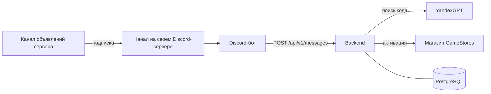

# Regular Codes

Приложение для автоматической активации промокодов на серверах сообщества по игре Rust.

Discord-бот читает объявления сервера, нейросеть YandexGPT находит в них промокоды, а backend сам активирует каждый найденный код на всех подключённых аккаунтах магазина [Syndicate](https://syndicate.gamestores.app) (платформа GameStores).

## Как это работает



1. Канал объявлений сервера подписан на канал вашего собственного Discord-сервера. Discord сам копирует туда каждое новое объявление.
2. **Discord-бот** слушает этот канал и отправляет текст сообщения (вместе с содержимым embed-ов) в backend. При каждом подключении к Discord бот перечитывает историю канала за последние 7 дней, поэтому объявления, пришедшие во время простоя, не теряются.
3. **Backend** сохраняет сообщение и просит YandexGPT найти в нём промокоды. Повторно присланное сообщение не проверяется заново: дубли определяются по паре `source` + `external_id`.
4. Найденные коды активируются в фоне на всех активных аккаунтах магазина. Каждый код пробуется на каждом аккаунте не больше одного раза, с паузой между аккаунтами. Если магазин отвечает «Промокод не найден», остальные аккаунты не пробуются. Если сессия аккаунта истекла, аккаунт помечается как `expired`.
5. Аккаунты магазина добавляются на странице `/admin/accounts`. Сессии хранятся в базе в зашифрованном виде (Fernet).

## Стек

- **Backend:** Python 3.12, FastAPI, SQLAlchemy 2 (async) + asyncpg, Alembic, PostgreSQL 17, pydantic-settings, httpx2, OpenAI SDK (для YandexGPT), cryptography, Jinja2.
- **Discord-бот:** Python 3.12, discord.py, httpx2, pydantic-settings.
- **Инструменты:** uv, ruff, pytest, Docker Compose.

## Структура репозитория

```
backend/                FastAPI-приложение
  app/
    admin/              страница добавления аккаунтов (/admin/accounts)
    api/                HTTP API: /health, /api/v1/messages
    clients/            клиенты YandexGPT и магазина GameStores
    core/               настройки и шифрование сессий
    crud/               запросы к базе (без commit)
    db/                 подключение к базе, базовая модель
    models/             таблицы SQLAlchemy
    schemas/            схемы запросов и ответов API
    services/           логика: поиск кодов, активация, аккаунты
  migrations/           миграции Alembic
  tests/
bots/discord/           Discord-бот
  bot/
  tests/
secrets/                секреты (в git не попадают)
compose.yaml            общая конфигурация Docker Compose
compose.override.yaml   dev: порты на 127.0.0.1, dev-образы, watch
compose.prod.yaml       prod: перезапуск сервисов
```

## Подготовка к первому запуску

### 1. Секреты

Каждый секрет — отдельный файл в папке `secrets/`, одна строка. Папка в `.gitignore`.

| Файл | Что это |
|---|---|
| `app_db_password` | Пароль PostgreSQL, любой |
| `app_yandex_api_key` | API-ключ сервисного аккаунта Yandex Cloud с доступом к YandexGPT |
| `app_session_encryption_key` | Ключ шифрования сессий магазина (Fernet) |
| `app_admin_password` | Пароль страницы `/admin/accounts` (логин `admin`) |
| `bot_discord_token` | Токен Discord-бота |

Случайные пароли и ключ шифрования можно сгенерировать так:

```bash
openssl rand -hex 24 > secrets/app_db_password
```

```bash
openssl rand -hex 24 > secrets/app_admin_password
```

```bash
uv run --project backend python -c "from cryptography.fernet import Fernet; print(Fernet.generate_key().decode())" > secrets/app_session_encryption_key
```

> Ключ шифрования нельзя терять и менять: без него сохранённые сессии не расшифровать, и аккаунты придётся добавлять заново.

Токен и API-ключ лучше записывать так, чтобы они не попали в историю команд:

```bash
read -rs "TOKEN?Discord bot token: " && printf '%s' "$TOKEN" > secrets/bot_discord_token && unset TOKEN
```

### 2. Переменные окружения

```bash
cp .env.example .env
```

| Переменная | Что это |
|---|---|
| `DB_USER`, `DB_NAME` | Пользователь и имя базы (по умолчанию `app`) |
| `YANDEX_FOLDER_ID` | ID каталога Yandex Cloud |
| `DISCORD_CHANNEL_IDS` | ID каналов, которые слушает бот, в формате JSON: `[123456789012345678]`. Нужен хотя бы один |
| `COMPOSE_FILE` | Можно раскомментировать на сервере, чтобы не указывать prod-файлы в каждой команде |

Остальные настройки (модель YandexGPT, таймауты и т. п.) имеют значения по умолчанию в `backend/app/core/config.py` и `bots/discord/bot/config.py`.

### 3. Discord

1. Создайте приложение на https://discord.com/developers/applications.
2. Во вкладке **Bot** включите **Message Content Intent**, выключите **Public Bot** и получите токен (**Reset Token**).
3. Во вкладке **OAuth2 → URL Generator** отметьте scope `bot` и права **View Channels** и **Read Message History**, откройте ссылку и добавьте бота на свой сервер.
4. В канале объявлений нужного сервера нажмите **«Подписаться»** и выберите канал на своём сервере.
5. Включите **Режим разработчика** (Настройки → Расширенные), скопируйте ID своего канала и укажите его в `DISCORD_CHANNEL_IDS`.

## Запуск

### Dev

```bash
docker compose up --build --watch
```

Compose поднимает базу, применяет миграции (сервис `migrate`), запускает backend и бота, когда backend проходит healthcheck. Изменения в `backend/app` и `bots/discord/bot` подхватываются без пересборки, изменения зависимостей и Dockerfile — с пересборкой.

- API: http://127.0.0.1:8000/docs
- Страница аккаунтов: http://127.0.0.1:8000/admin/accounts
- База: `127.0.0.1:5432`

Логи бота:

```bash
docker compose logs -f discord-bot
```

### Prod

```bash
docker compose -f compose.yaml -f compose.prod.yaml up -d --build --wait
```

В prod порты backend и базы наружу не публикуются, а сервисы перезапускаются после сбоев.

## Добавление аккаунта магазина

1. Откройте **приватное окно** браузера и войдите на сайт магазина через Steam.
2. В инструментах разработчика (**Хранилище → Cookies**) скопируйте значение cookie `SessionShop`.
3. Вставьте его на странице `/admin/accounts`. Приложение проверит сессию в магазине и сохранит аккаунт по Steam ID. Повторное добавление того же аккаунта обновляет его сессию.
4. Закройте приватное окно, **не нажимая «Выйти»**: выход завершает сессию на стороне магазина.

Когда сессия истекает, аккаунт получает статус `expired`. Чтобы снова включить его, добавьте свежую сессию тем же способом.

## API

| Метод | Путь | Описание |
|---|---|---|
| `GET` | `/health` | Проверка приложения и базы |
| `POST` | `/api/v1/messages` | Принять сообщение, найти в нём коды и запустить активацию |

Пример:

```bash
curl -s -X POST http://127.0.0.1:8000/api/v1/messages \
  -H 'Content-Type: application/json' \
  -d '{"source": "discord", "external_id": "1", "text": "Промокод на кит: RUST2026"}'
```

```json
{"id": 1, "status": "processed", "codes": ["RUST2026"]}
```

Статус `failed` означает, что YandexGPT не ответил. Повторная отправка того же сообщения проверит его заново.

## Разработка

### Тесты и линтер

Тесты backend работают с настоящим PostgreSQL на `127.0.0.1:5432` (в dev он уже открыт) и при каждом запуске пересоздают отдельную базу `app_test`. Пароль берётся из `secrets/app_db_password`.

```bash
cd backend && uv run pytest
```

```bash
cd bots/discord && uv run pytest
```

Проверка стиля (в каждом из проектов):

```bash
uv run ruff check . && uv run ruff format --check .
```

### Миграции

После изменения моделей:

```bash
docker compose exec backend alembic revision --autogenerate -m "describe change"
```

```bash
docker compose exec backend alembic upgrade head
```

Новые файлы миграций автоматически форматируются ruff. При обычном запуске compose миграции применяет сервис `migrate`.

### Устройство backend

- `crud/` — только запросы к базе, без `commit`.
- `services/` — логика приложения: вызывают `crud`, добавляют объекты в сессию и делают `commit`.
- Маршруты могут читать данные напрямую через `crud`.
- Клиенты внешних сервисов создаются один раз в `lifespan` и подставляются через зависимости FastAPI, поэтому в тестах их легко заменить.

## Ограничения и правила

- Один код пробуется на одном аккаунте не больше одного раза. Между аккаунтами и между сообщениями из истории есть паузы, чтобы не нагружать магазин.
- Приложение не обходит защиту магазина от ботов и не хранит пароли Steam. Новую сессию можно получить только ручным входом через Steam.
- Сейчас поддерживается один магазин — Syndicate.

## Планы

- Личный кабинет для друзей: вход через Steam, статусы своих сессий, проверка и обновление сессии, история активаций.
- Фоновая проверка сессий и повтор неудачных активаций.
- Выкладка на сервер с HTTPS.
